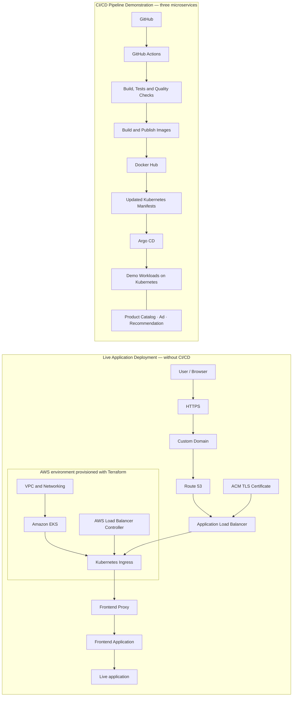
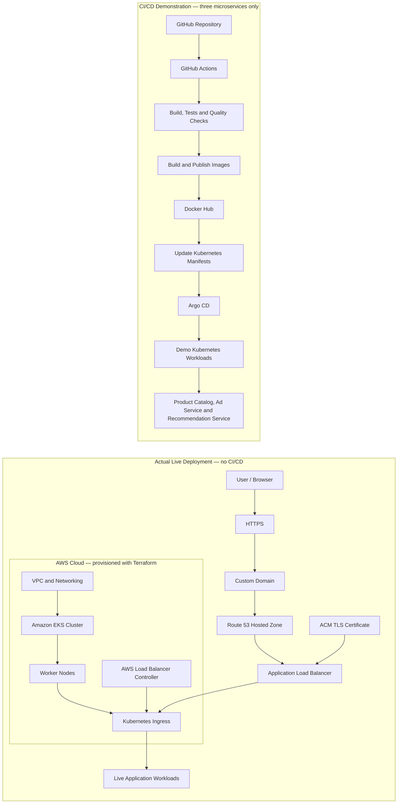
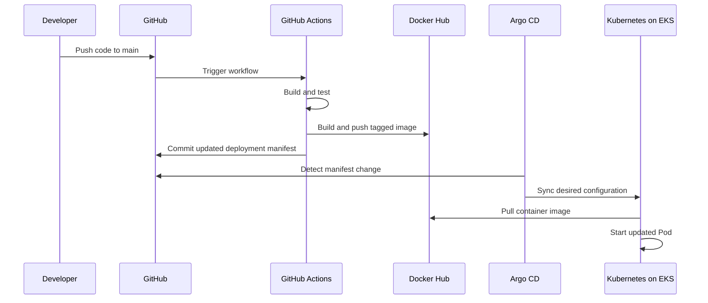

# OpenTelemetry Astronomy Shop --- AWS EKS Deployment

A hands-on DevOps project involving the deployment of the
**OpenTelemetry Astronomy Shop**---a microservice-based distributed
application designed to demonstrate OpenTelemetry in a near-real-world
environment---to **Amazon EKS**.

The live application was deployed to EKS and made accessible through a
custom domain with HTTPS. Separately, a CI/CD and GitOps workflow was
implemented as a demonstration using three selected microservices; this
pipeline was not used to deploy the live application.

> **Project scope:** The live EKS deployment and the CI/CD demonstration
> are separate parts of this project. The live application deployment
> was carried out without the CI/CD pipeline, while the pipeline
> demonstration covered three selected microservices rather than every
> service in the Astronomy Shop.


💻 **My repository:**
[Ifeday0/ultimate-devops-project-demo](https://github.com/Ifeday0/ultimate-devops-project-demo)\
📦 **Original project:**
[iam-veeramalla/ultimate-devops-project-demo](https://github.com/iam-veeramalla/ultimate-devops-project-demo)\
🎥 **Video demonstration:** https://github.com/user-attachments/assets/5e85c47d-1fc3-4407-be5a-3a277f334d99
🎥 **Video demonstration:** https://github.com/user-attachments/assets/0290b78a-6754-447d-bc5f-aa678ea8de8b
------------------------------------------------------------------------

## ✨ Project Highlights

-   ☁️ Provisioned AWS networking and an Amazon EKS cluster using
    Terraform.
-   🐳 Containerized selected application services with Docker.
-   ⚙️ Implemented a GitHub Actions CI/CD workflow demonstration for
    build, test, code-quality checks, and image publishing; it was not
    used for the live application deployment.
-   🚀 Demonstrated Argo CD reconciliation of Kubernetes manifests from
    Git as part of the CI/CD workflow.
-   🗂️ Stored and published container images to Docker Hub.
-   🌍 Connected a custom domain using GoDaddy DNS delegation and Amazon
    Route 53.
-   🔐 Configured HTTPS with AWS Certificate Manager (ACM) and an
    Application Load Balancer (ALB).
-   📈 Used the OpenTelemetry Astronomy Shop as a distributed,
    microservice-based application example.

## 🧩 Application Overview

The Astronomy Shop is a distributed application made up of
independently deployable services. The live application was deployed to
Amazon EKS and exposed through a custom domain with HTTPS. The separate
CI/CD demonstration covered three microservices: Product Catalog,
Ad Service, and Recommendation Service.

The diagrams below distinguish the actual live deployment from the
CI/CD demonstration. The live deployment used Terraform-provisioned AWS
infrastructure and Kubernetes Ingress resources; it was not deployed
through the CI/CD pipeline.



## 🏗️ AWS and Deployment Architecture

The live application infrastructure and the CI/CD demonstration are
separate. Terraform was used to provision the AWS platform for the live
EKS deployment, which was exposed through Route 53, an ALB, Kubernetes
Ingress, and HTTPS. GitHub Actions and Argo CD were used separately to
demonstrate a CI/CD and GitOps workflow for three microservices; that
workflow did not deploy the live application.



### 🧱 Infrastructure provisioning


Terraform was used to provision the foundational AWS infrastructure,
including:

-   **VPC and networking:** Created the network environment and subnets
    required by the EKS deployment.
-   **Amazon EKS:** Provisioned the Kubernetes control plane and worker
    capacity.
-   **Kubernetes deployment platform:** Prepared the cluster for
    application workloads and the AWS Load Balancer Controller.

The infrastructure-as-code approach makes the environment easier to
reproduce and manage than manually creating each resource in the AWS
console.

### 🌐 Domain, DNS and HTTPS


The application was exposed through a custom domain:

1.  Registered the domain with GoDaddy.
2.  Created a public hosted zone in Amazon Route 53.
3.  Updated the domain's nameserver records at GoDaddy to delegate DNS
    management to Route 53.
4.  Created Route 53 Alias records for the root domain and `www`,
    pointing to the application load balancer.
5.  Requested and DNS-validated an SSL/TLS certificate in AWS
    Certificate Manager.
6.  Configured the Kubernetes Ingress with the ALB certificate, HTTP and
    HTTPS listeners, and an HTTP-to-HTTPS redirect.

**Result:** Both `https://ifecloudevopsmaster.online` and
`https://www.ifecloudevopsmaster.online` returned successful HTTPS
responses.


TLS terminates at the ALB. The ALB forwards traffic to the frontend
proxy service in the EKS cluster.

## 🔄 CI/CD and GitOps Workflow

The CI/CD workflow below is a demonstration involving three selected
microservices: Product Catalog, Ad Service, and Recommendation Service.
It is separate from the live application deployment described above;
the live application was deployed to EKS without this pipeline.

### 1. Continuous Integration --- GitHub Actions


A push or pull request targeting `main` triggers the workflow:

-   Checks out the repository.
-   Sets up the Go environment.
-   Downloads dependencies.
-   Builds the Product Catalog service.
-   Runs Go unit tests.
-   Runs code-quality checks in a separate job.

The code-quality job is independent of the deployment jobs. A lint
failure is reported, but it does not prevent the Docker publishing and
manifest-update jobs from running when the build and tests succeed.

### 2. Containerization and image publishing


After a successful build on `main`:

-   Docker Buildx builds the service image.
-   GitHub Actions authenticates to Docker Hub using repository secrets.
-   The image is pushed to Docker Hub with a unique GitHub Actions run
    ID as its tag.

Example image tag format:

``` text
<docker-hub-username>/product-catalog:<github-run-id>
```

### 3. Continuous Deployment --- Argo CD


For the CI/CD demonstration, after the image is published:

1.  GitHub Actions updates the Product Catalog Kubernetes deployment
    manifest with the new image tag.
2.  The workflow commits and pushes the manifest change to the GitHub
    repository.
3.  Argo CD detects the Git change and synchronizes the desired
    Kubernetes configuration with the EKS cluster.
4.  Kubernetes schedules the updated workload and the node's container
    runtime pulls the image from Docker Hub.

**Important:** This sequence describes the CI/CD demonstration, not
the deployment process used for the live application. Argo CD
synchronizes Kubernetes configuration from Git. It does not pull the
container image itself; Kubernetes pulls the image when creating the
Pod.



## 🧰 Technology Stack

  -----------------------------------------------------------------------
  Area                                Tools / Services
  ----------------------------------- -----------------------------------
  Application                         OpenTelemetry Astronomy Shop, Go
                                      service

  Source control                      Git, GitHub

  Infrastructure as Code              Terraform

  Cloud platform                      AWS

  Containerization                    Docker, Docker Buildx

  Container registry                  Docker Hub

  CI                                  GitHub Actions

  CD / GitOps                         Argo CD

  Orchestration                       Kubernetes, Amazon EKS

  Ingress and load balancing          Kubernetes Ingress, AWS Load
                                      Balancer Controller, ALB

  DNS                                 GoDaddy, Amazon Route 53

  TLS                                 AWS Certificate Manager
  -----------------------------------------------------------------------

## 🧠 Challenges and Solutions

| Challenge | How it was addressed |
|---|---|
| **Challenge:** Accessing the application through the ALB initially returned a 404 response. | **Solution:** Investigated host-based Ingress routing, tested requests using the expected host header, and configured the custom domain to route to the ALB. |
| **Challenge:** The custom domain was not resolving through AWS. | **Solution:** Created a Route 53 hosted zone and updated the domain nameservers at GoDaddy to delegate DNS to Route 53. |
| **Challenge:** Enabling HTTPS for the custom domain. | **Solution:** Requested an ACM certificate, completed DNS validation, and attached the certificate to the ALB HTTPS listener through Ingress annotations. |
| **Challenge:** The GitHub Actions workflow did not initially run for the intended pull request. | **Solution:** Corrected the pull request base/compare branch selection so the feature branch targeted `main`. |
| **Challenge:** Docker Hub authentication failed in the pipeline. | **Solution:** Regenerated a Docker Hub access token with the required permissions and updated the GitHub repository secrets. |
| **Challenge:** Code-quality failures could block the deployment pipeline. | **Solution:** Separated code-quality checks from the deployment dependency chain, so image publishing can proceed when the build and tests pass. |
| **Challenge:** Argo CD reported the Product Catalog application as Degraded because a new Pod could not be scheduled. | **Solution:** Investigated ReplicaSets and scheduler events. The worker nodes had a Pod capacity of 17 each and were reporting `Too many pods`; the image tag itself was correct. This identified a cluster scheduling-capacity constraint rather than an image-version problem. |

## ✅ Verification

The following checks were used during implementation:

``` bash
# Check cluster nodes
kubectl get nodes -o wide

# Check application resources
kubectl get applications -n argocd

# Check Pods across namespaces and their assigned nodes
kubectl get pods -A -o wide

# Check the application Ingress
kubectl get ingress

# Verify HTTP redirects to HTTPS
curl -I http://ifecloudevopsmaster.online

# Verify HTTPS response
curl -I https://ifecloudevopsmaster.online
curl -I https://www.ifecloudevopsmaster.online
```

The custom domain returned successful HTTPS responses. The Product
Catalog rollout also exposed a worker-node Pod-capacity limit during
scheduling; this is documented as an infrastructure constraint
discovered during validation.

## 📌 Project Outcome

This project demonstrates two related but separate DevOps outcomes:
a live application deployment to Amazon EKS using Terraform-provisioned
AWS infrastructure, a custom domain, and HTTPS; and a CI/CD/GitOps
workflow demonstration for three selected microservices using GitHub
Actions, Docker Hub, and Argo CD. The CI/CD demonstration was not used
to deploy the live application.

It also provided hands-on experience troubleshooting real deployment
concerns involving DNS delegation, TLS certificates, ALB/Ingress
routing, CI workflow triggers, registry authentication, GitOps
synchronization, and Kubernetes scheduling capacity.

------------------------------------------------------------------------

**Note:** This is a focused implementation of selected services from the
upstream OpenTelemetry Astronomy Shop project, not a full deployment of
every microservice in the original application.
